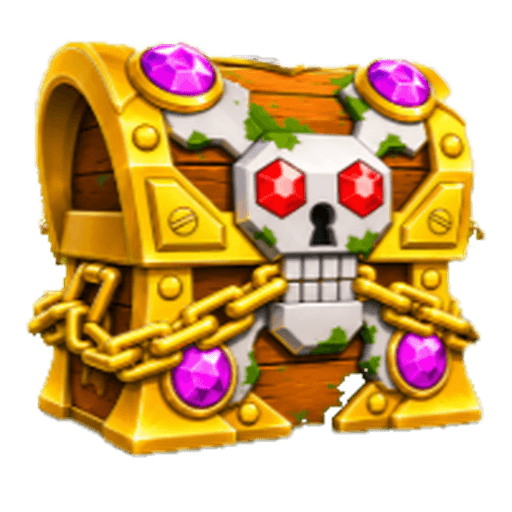
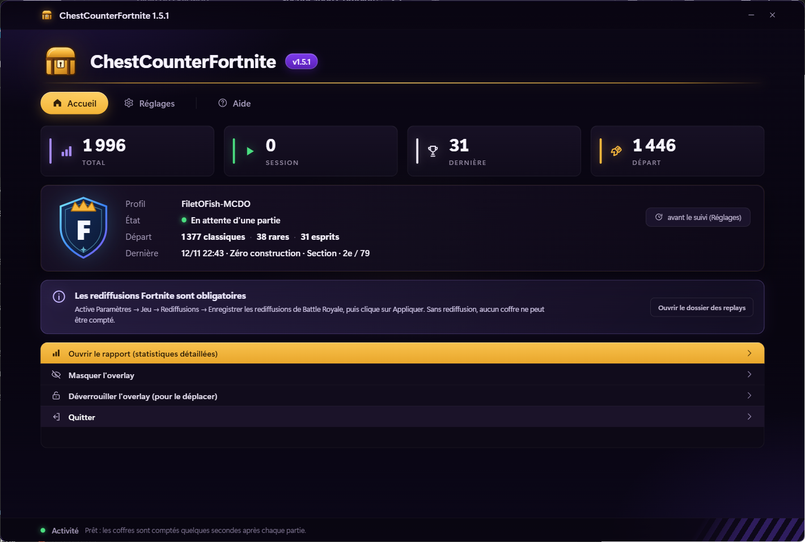

<div align="center">



# ChestCounterFortnite

**Tes coffres Fortnite, comptés automatiquement.**

Historique, statistiques et overlays OBS/TikTok, avec synchronisation entre tes PC.

[](https://github.com/emilien-atr/ChestCounterFortnite/releases/latest)
[](#)
[](LICENSE)



</div>

## En bref

- Compte les coffres à partir des **rediffusions Fortnite**, quelques secondes après chaque partie.
- Affiche la **carte violette** en jeu et fournit un **overlay de stream compact** pour OBS et TikTok Live Studio.
- L’overlay **s’adapte automatiquement à la taille de la source** : aucune taille fixe à régler.
- **Compte obligatoire et synchronisation** : connecte-toi par e-mail, ou avec Google lorsque le provider est activé dans Supabase, pour retrouver ton historique et tes totaux sur tes autres PC. Un lien **Mot de passe oublié ?** permet de choisir un nouveau mot de passe sans quitter l’application.
- Rapports web, historique, archives ZIP, activité Discord et mises à jour automatiques.
- Français, anglais et espagnol.

## Installation

1. Télécharge l’[installateur de la dernière version](https://github.com/emilien-atr/ChestCounterFortnite/releases/latest).
2. Lance `ChestCounterFortnite-Setup.exe` et suis l’assistant. L’installation se fait pour ton compte, dans `%LOCALAPPDATA%\Programs\ChestCounterFortnite`, sans droits administrateur.
3. Active les rediffusions dans **Fortnite → Paramètres → Jeu → Rediffusions**, puis clique sur **Appliquer**.

L’installateur crée le raccourci **ChestCounterFortnite** sur le Bureau et dans le menu Démarrer. Windows peut afficher un avertissement SmartScreen car l’installateur n’est pas signé : **Informations complémentaires → Exécuter quand même**. Les données de l’application restent dans `%APPDATA%\ChestCounterFortnite` et sont conservées à la désinstallation.

## Compte et synchronisation

La connexion est **nécessaire** pour utiliser le compteur, y compris quand ChestCounterFortnite est lancé automatiquement avec Fortnite. Une fois connecté, l’historique et les totaux manuels suivent le compte sur tous tes PC ; les réglages et les fichiers `.replay` restent locaux. L’application est déjà reliée au projet Supabase : aucune URL ni clé n’est demandée aux utilisateurs. La configuration technique du projet est décrite dans [`docs/SUPABASE.md`](docs/SUPABASE.md).

La connexion Google est prise en charge par l’application, mais elle doit être activée dans le projet Supabase (**Authentication → Providers → Google**). Tant que le provider n’est pas activé, utilise l’adresse e-mail et le mot de passe.

### Mot de passe oublié

Depuis l’écran de connexion, clique sur **Mot de passe oublié ?**, saisis l’adresse du compte, puis ouvre le lien reçu **sur le même PC**. Garde ChestCounterFortnite ouvert : le lien revient dans l’application, qui affiche le formulaire **Nouveau mot de passe**. Après validation, la session est ouverte et la synchronisation reprend.

## Overlay de stream


- **Overlay de jeu** : version compacte pour le stream, avec le total et le badge LIVE.
- Il s’adapte à la source, sans redimensionnement manuel.

Dans OBS, ajoute une source **Navigateur**. Dans TikTok Live Studio, utilise une source **Lien** et colle le **lien HTTPS** affiché dans **Réglages → OBS / TikTok Live Studio**. Garde le compteur ouvert pendant le live.

## Données

Tout est enregistré dans `%APPDATA%\ChestCounterFortnite`. Les replays restent sur ton disque ; avec un compte, seul l’historique est synchronisé. Aucune donnée de jeu n’est envoyée sans connexion.

## Nouveautés 1.6.0

- **Installateur séparé** : `ChestCounterFortnite-Setup.exe` installe l’application pour l’utilisateur, crée les raccourcis et s’inscrit dans « Applications installées » pour la désinstallation.
- **Fini l’auto-installation portable** : l’application ne crée plus de raccourci Bureau à son premier lancement ; c’est l’installateur qui s’en charge.
- **Mises à jour conservées** : l’auto-update remplace toujours le binaire installé, sans repasser par l’installateur. Les données et les replays restent locaux.

<details>
<summary><b>Compiler depuis les sources</b></summary>

Prérequis : **.NET 10 SDK**, **Inno Setup 6** et Windows 10/11.

```bat
dotnet publish src/ChestCounter/ChestCounter.csproj -c Release -r win-x64 --self-contained true -p:PublishSingleFile=true -p:IncludeNativeLibrariesForSelfExtract=true -p:EnableCompressionInSingleFile=true -p:DebugType=none -o dist
"C:\Program Files (x86)\Inno Setup 6\ISCC.exe" /DAppVersion=1.6.0 installer\ChestCounter.iss
```

L’installateur est écrit dans `dist-installer\ChestCounterFortnite-Setup.exe`.

</details>

## Licence et crédits

[MIT](LICENSE) © 2026 **Emilien Autran**. Projet indépendant inspiré de [LED-N/Fortnite-ChestCounter](https://github.com/LED-N/Fortnite-ChestCounter) (MIT), avec [FortniteReplayReader](https://github.com/Shiqan/FortniteReplayReader), OozSharp, Unreal.Core, [DiscordRichPresence](https://github.com/Lachee/discord-rpc-csharp) (MIT) et la police Pirata One (SIL OFL).

Ce projet n’est ni affilié, ni approuvé, ni sponsorisé par Epic Games. Fortnite est une marque d’Epic Games, Inc.
