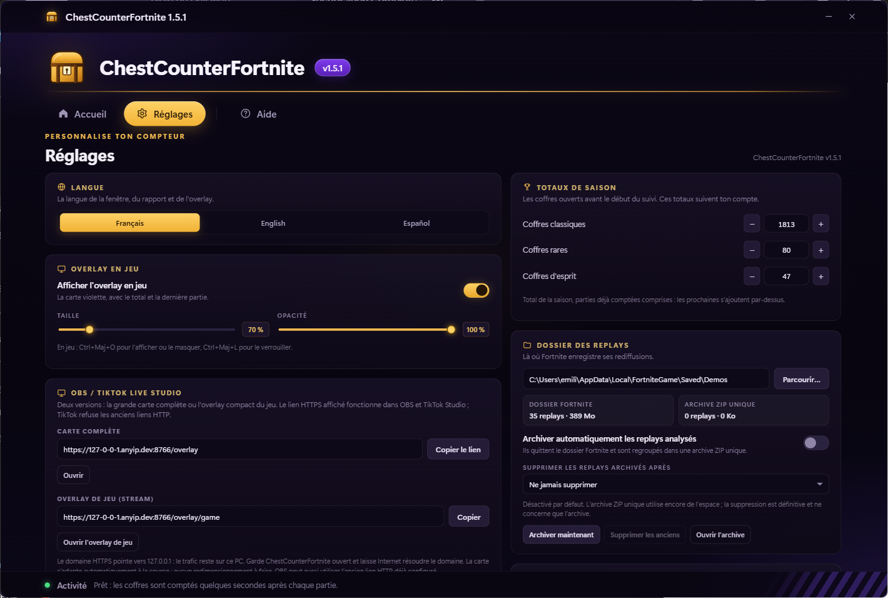
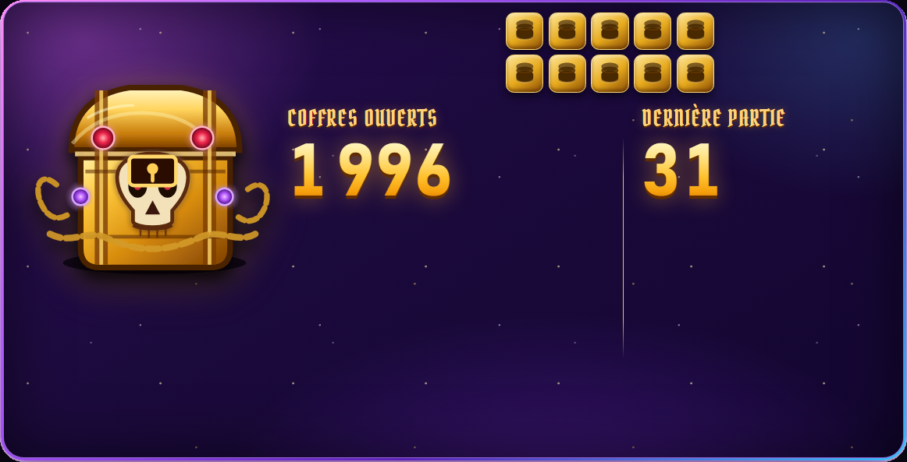

<div align="center">


# ChestCounterFortnite

**Tes coffres Fortnite, comptés automatiquement.**

Un overlay discret, un rapport clair, et ton historique synchronisé entre tes PC si tu le souhaites.

[](https://github.com/emilien-atr/ChestCounterFortnite/releases/latest)
[](#)
[](LICENSE)


</div>

## En bref

- Compte les coffres à partir des **rediffusions Fortnite**, quelques secondes après chaque partie.
- Ne prend en compte que les parties **à partir du 1er novembre 2026**.
- Affiche la **carte violette** en jeu, avec le total et la dernière partie.
- Fournit **deux liens de source navigateur** pour OBS ou TikTok Live Studio : la grande carte pirate (total, partie en cours, récompenses) et l'**overlay de jeu compact** `/overlay/game`, dans le style de l'overlay natif.
- **Overlay auto-adaptatif** : les deux cartes se dimensionnent selon la source OBS/TikTok, sans taille fixe à régler.
- **Activité Discord** : si Discord desktop est ouvert, ton profil affiche le compteur avec un minuteur de session et deux boutons (GitHub / téléchargement), même quand Fortnite est lancé. La première ligne (« Joue à … ») reprend le nom de l'application Discord ; les deux lignes suivantes et les boutons sont ceux du compteur.
- Garde l’historique, les sessions et les trésors dans un **rapport web** local.
- **Compte optionnel** : connecte-toi par e-mail ou avec Google pour retrouver le même historique sur plusieurs PC via Supabase.
- Français, anglais et espagnol.
- **Mises à jour automatiques** depuis GitHub.
- Aucun compte obligatoire, aucune publicité, aucune donnée de jeu envoyée. L'activité Discord et la synchronisation cloud sont optionnelles ; les fichiers de replay restent sur ton disque.

## Nouveautés de la 1.5


- **Connexion au démarrage** : un compte par e-mail ou avec Google, ou « Plus tard, rester en local ».
- **Synchronisation multi-PC** : historique et totaux manuels suivent le compte ; les fichiers de replay restent sur chaque PC.
- **Overlay auto-adaptatif** : la carte pirate et `/overlay/game` se dimensionnent selon la source OBS/TikTok ; plus de taille 1920 × 1080 à régler.
- **TikTok Studio** : liens HTTPS locaux acceptés, sans tunnel ni certificat à installer.

## Installation

1. Télécharge la [dernière version](https://github.com/emilien-atr/ChestCounterFortnite/releases/latest).
2. Active les rediffusions dans **Fortnite → Paramètres → Jeu → Rediffusions → Enregistrer les rediffusions de Battle Royale**, puis clique sur **Appliquer**. Sans replay, aucun coffre ne peut être compté.
3. Lance `ChestCounterFortnite.exe`. Windows peut afficher un avertissement car l’exécutable n’est pas signé : **Informations complémentaires → Exécuter quand même**.

## Mises à jour automatiques

À partir de la version **1.2**, chaque mise à jour du dépôt (`push` sur `main`) construit et publie une nouvelle release. Le compteur vérifie GitHub au démarrage puis régulièrement : il télécharge la nouvelle version, remplace son exe et redémarre tout seul.

Une version antérieure à la 1.2 (sans updater) doit être remplacée **une seule fois** par cette version. Ensuite, plus besoin de retélécharger quoi que ce soit.

## Période comptée

Seules les parties **commencées le 1er novembre 2026 ou après** sont comptées et affichées dans le compteur, l’overlay et le rapport. Les replays plus anciens restent dans `data.json` mais ne participent plus aux statistiques.

## Calcul des coffres

Le total additionne **tous les coffres trouvés dans les replays** : coffres classiques, rares, enterrés, coffres d’esprit, coffres des affiches et autres coffres. Les coffres **cassés au lieu d’être ouverts** sont directement inclus dans ce total, sans ligne séparée ; la dernière partie suit le même calcul. Les caisses de munitions, caisses de nourriture et autres conteneurs restent suivis séparément dans le rapport.

## Interface

- **Accueil** : total, session, dernière partie, profil et actions rapides (rapport, overlay, verrouillage). La croix de la fenêtre range le compteur dans la zone de notification ; il continue de tourner en arrière-plan.
- **Réglages** : langue, overlay, compte et synchronisation, lien OBS/TikTok Live Studio, dossier des replays, totaux de saison et comportement.
- **Aide** : rappels, raccourcis et dossier de données.



Le rapport s’ouvre dans le navigateur et se met à jour automatiquement pendant l’analyse.

## Compte et synchronisation

Au lancement, une page de connexion propose un compte par **adresse e-mail** ou avec **Google**. Elle peut être passée avec **Plus tard, rester en local** et rouverte depuis **Réglages → Synchronisation**.

Une fois connecté, l'historique et les statistiques sont synchronisés dans une table Supabase protégée par RLS. Les parties sont fusionnées par identifiant de replay : une partie analysée sur deux PC n'apparaît qu'une fois. Les réglages d'overlay et de dossier restent propres à chaque PC ; les fichiers `.replay` ne sont jamais envoyés. Les totaux manuels de saison (coffres classiques, rares et d'esprit) suivent le compte et sont restaurés sur les autres PC.

La configuration du projet Supabase, de Google et de l'URL de retour est détaillée dans [`docs/SUPABASE.md`](docs/SUPABASE.md).

## Raccourcis

| Raccourci | Action |
|---|---|
| **Ctrl+Maj+O** | Afficher ou masquer l’overlay, même en jeu. |
| **Ctrl+Maj+L** | Verrouiller ou déverrouiller l’overlay. Verrouillé, la souris le traverse ; déverrouillé, maintiens le clic gauche pour le déplacer et utilise le clic droit pour le masquer. |

## Overlay



- **Carte violette en jeu** : la carte compacte, avec le petit coffre dans l'en-tête, le total en or et la dernière partie. Une animation brève fait monter le total quand un nouveau coffre est ajouté, puis la carte reste immobile.
- **Carte OBS / TikTok Live Studio** : la grande carte pirate avec le coffre à crâne, les deux compteurs en or et la grille des **10 récompenses Treasure Hunt**. Une récompense déjà trouvée dans tes replays est automatiquement barrée d'une croix rouge ; les autres restent en or. La grille se remplit à partir du `PrizeId` du coffre doré, sans clic manuel.
- **Overlay de jeu pour le stream** : la carte compacte de l'overlay natif, servie sur `/overlay/game`. Idéale pour un rappel discret dans OBS ou TikTok Live Studio, avec le total, la partie en cours ou la dernière partie et le badge LIVE.

Les deux pages de stream se dimensionnent automatiquement à la source : la carte compacte utilise jusqu’à **92 % de la largeur** (maximum 960 px), et la grande carte conserve une marge automatique. Aucune taille fixe n’est à régler.

La taille de la **carte violette en jeu** se règle de **50 à 175 %** et son opacité de **30 à 100 %** dans **Réglages → Overlay en jeu**. Pour l’afficher au-dessus du jeu, utilise le mode **Plein écran fenêtré** de Fortnite.

## OBS / TikTok Live Studio

Pour afficher un overlay dans un live :

1. Ouvre **Réglages → OBS / TikTok Live Studio** et choisis **Carte complète** ou **Overlay de jeu (stream)**, puis clique sur **Copier** (ou **Copier le lien**).
2. Dans OBS, ajoute une source **Navigateur** et colle le lien. Dans TikTok Live Studio, choisis une source **Lien** et colle le **lien HTTPS** affiché : TikTok refuse les URL locales en `http://`.
3. Laisse la source à la taille de ton canvas : la carte et l'overlay de jeu s'adaptent automatiquement à la source, sans redimensionnement manuel. Le fond de la page est transparent ; pour l'overlay de jeu, une source plus compacte suffit.

Les liens restent servis sur ce PC. Le lien TikTok utilise `https://127-0-0-1.anyip.dev:<port>/overlay`, un domaine public qui pointe vers `127.0.0.1` : le trafic ne sort pas de la machine et aucun certificat n’est à installer. Une connexion Internet est nécessaire pour résoudre ce domaine. L’ancien lien HTTP reste disponible pour les sources OBS déjà configurées. Le compteur doit rester ouvert pendant le live ; le port peut changer si le port préféré est déjà occupé : utilise toujours le lien affiché dans l’application.

## Données

Par défaut, tout reste sur le PC, dans `%APPDATA%\ChestCounterFortnite` :

- `data.json` : historique ;
- `config.json` : réglages et position de l’overlay ;
- `report.html` : rapport web ;
- `matches.csv` : parties exportables ;
- `replay-archive/` : `replays.zip`, une archive ZIP unique contenant les replays déjà analysés déplacés depuis le dossier Fortnite (optionnel) ;
- `supabase.json` / `supabase-session.json` : configuration et session cloud, uniquement si tu actives la synchronisation.

Le compteur ne modifie jamais Fortnite et ne lit pas sa mémoire. Sans connexion, aucune donnée n’est envoyée sur Internet, hors vérification des mises à jour GitHub et activité Discord optionnelle. Avec un compte, le contenu de `data.json` est copié dans ton projet Supabase et associé à ton utilisateur ; les replays et les réglages locaux ne sont pas envoyés. Le lien de diffusion est servi uniquement en local : le domaine HTTPS public pointe vers `127.0.0.1`.

## Compiler

Prérequis : **.NET 10 SDK** et Windows 10/11.

```bat
dotnet publish src/ChestCounter/ChestCounter.csproj -c Release -r win-x64 --self-contained true -p:PublishSingleFile=true -p:IncludeNativeLibrariesForSelfExtract=true -p:EnableCompressionInSingleFile=true -p:DebugType=none -o dist
```

## Licence et crédits

[MIT](LICENSE) © 2026 **Emilien Autran**. Projet indépendant inspiré de [LED-N/Fortnite-ChestCounter](https://github.com/LED-N/Fortnite-ChestCounter) (MIT), avec [FortniteReplayReader](https://github.com/Shiqan/FortniteReplayReader), OozSharp, Unreal.Core, [DiscordRichPresence](https://github.com/Lachee/discord-rpc-csharp) (MIT) et la police Pirata One (SIL OFL).

Ce projet n’est ni affilié, ni approuvé, ni sponsorisé par Epic Games. Fortnite est une marque d’Epic Games, Inc.
