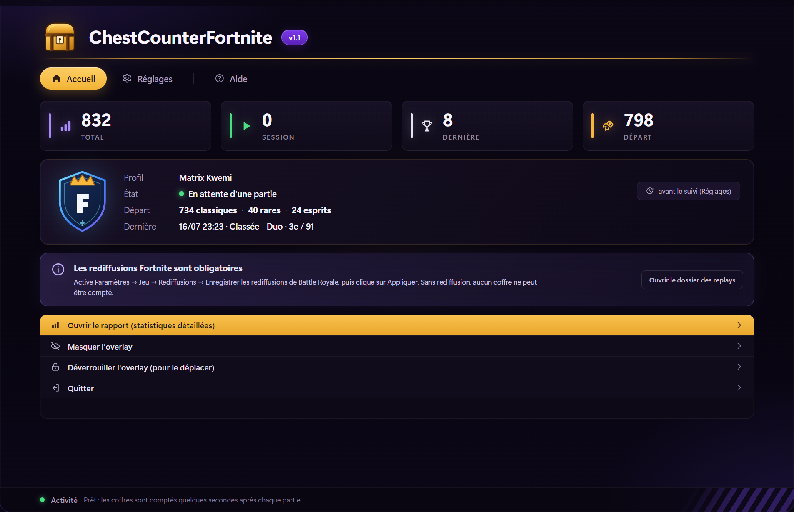
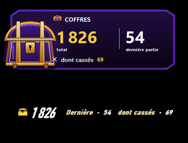

<div align="center">


# ChestCounterFortnite

**Tes coffres Fortnite, comptés automatiquement.**

Un overlay discret, un rapport clair et toutes tes données sur ton PC.

[](https://github.com/emilien-atr/ChestCounterFortnite/releases/latest)
[](#)
[](LICENSE)



</div>

## En bref

- Compte les coffres à partir des **rediffusions Fortnite**, quelques secondes après chaque partie.
- Ne prend en compte que les parties **à partir du 1er novembre 2026**.
- Affiche un **HUD sur une ligne** ou une carte classique, avec le total, la dernière partie et les coffres cassés.
- **Activité Discord** : si Discord desktop est ouvert, ton profil affiche le compteur avec le logo et un bouton GitHub.
- Garde l’historique, les sessions et les trésors dans un **rapport web** local.
- Français, anglais et espagnol.
- **Mises à jour automatiques** depuis GitHub.
- Aucun compte, aucune publicité, aucune donnée de jeu envoyée ; l'activité Discord est optionnelle et n'envoie que le total de coffres à Discord.

## Installation

1. Télécharge la [dernière version](https://github.com/emilien-atr/ChestCounterFortnite/releases/latest).
2. Active les rediffusions dans **Fortnite → Paramètres → Jeu → Rediffusions → Enregistrer les rediffusions de Battle Royale**, puis clique sur **Appliquer**. Sans replay, aucun coffre ne peut être compté.
3. Lance `ChestCounterFortnite.exe`. Windows peut afficher un avertissement car l’exécutable n’est pas signé : **Informations complémentaires → Exécuter quand même**.

## Mises à jour automatiques

À partir de la version **1.2**, chaque mise à jour du dépôt (`push` sur `main`) construit et publie une nouvelle release. Le compteur vérifie GitHub au démarrage puis régulièrement : il télécharge la nouvelle version, remplace son exe et redémarre tout seul.

Une version antérieure à la 1.2 (sans updater) doit être remplacée **une seule fois** par cette version. Ensuite, plus besoin de retélécharger quoi que ce soit.

## Période comptée

Seules les parties **commencées le 1er novembre 2026 ou après** sont comptées et affichées dans le compteur, l’overlay et le rapport. Les replays plus anciens restent dans `data.json` mais ne participent plus aux statistiques.

## Interface

- **Accueil** : total, session, dernière partie, profil et actions rapides (rapport, overlay, verrouillage).
- **Réglages** : langue, overlay, dossier des replays, totaux de saison et comportement.
- **Aide** : rappels, raccourcis et dossier de données.

Le rapport s’ouvre dans le navigateur et se met à jour automatiquement pendant l’analyse.

## Raccourcis

| Raccourci | Action |
|---|---|
| **Ctrl+Maj+O** | Afficher ou masquer l’overlay, même en jeu. |
| **Ctrl+Maj+L** | Verrouiller ou déverrouiller l’overlay. Verrouillé, la souris le traverse ; déverrouillé, maintiens le clic gauche pour le déplacer et utilise le clic droit pour le masquer. |

## Overlay



- **HUD** : une seule ligne, dans l’esprit du HUD Fortnite. Idéal sous la minimap.
- **Classique** : une carte compacte avec le coffre doré.

La taille se règle de **50 à 175 %** et l’opacité de **30 à 100 %** dans **Réglages → Overlay en jeu**. Pour l’afficher au-dessus du jeu, utilise le mode **Plein écran fenêtré** de Fortnite.

## Données

Tout reste sur le PC, dans `%APPDATA%\ChestCounterFortnite` :

- `data.json` : historique ;
- `config.json` : réglages et position de l’overlay ;
- `report.html` : rapport web ;
- `matches.csv` : parties exportables.

Le compteur ne modifie jamais Fortnite et ne lit pas sa mémoire. Le seul accès réseau sert à vérifier et télécharger les mises à jour GitHub.

## Compiler

Prérequis : **.NET 10 SDK** et Windows 10/11.

```bat
dotnet publish src/ChestCounter/ChestCounter.csproj -c Release -r win-x64 --self-contained true -p:PublishSingleFile=true -p:IncludeNativeLibrariesForSelfExtract=true -p:EnableCompressionInSingleFile=true -p:DebugType=none -o dist
```

## Licence et crédits

[MIT](LICENSE) © 2026 **Emilien Autran**. Projet indépendant inspiré de [LED-N/Fortnite-ChestCounter](https://github.com/LED-N/Fortnite-ChestCounter) (MIT), avec [FortniteReplayReader](https://github.com/Shiqan/FortniteReplayReader), OozSharp, Unreal.Core, [DiscordRichPresence](https://github.com/Lachee/discord-rpc-csharp) (MIT) et la police Pirata One (SIL OFL).

Ce projet n’est ni affilié, ni approuvé, ni sponsorisé par Epic Games. Fortnite est une marque d’Epic Games, Inc.
