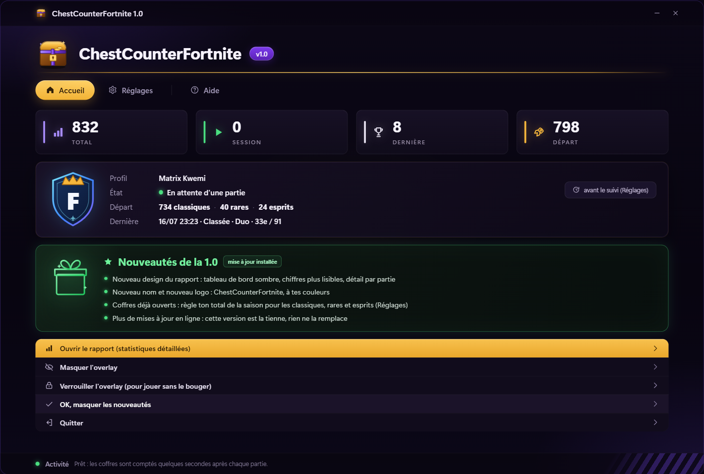
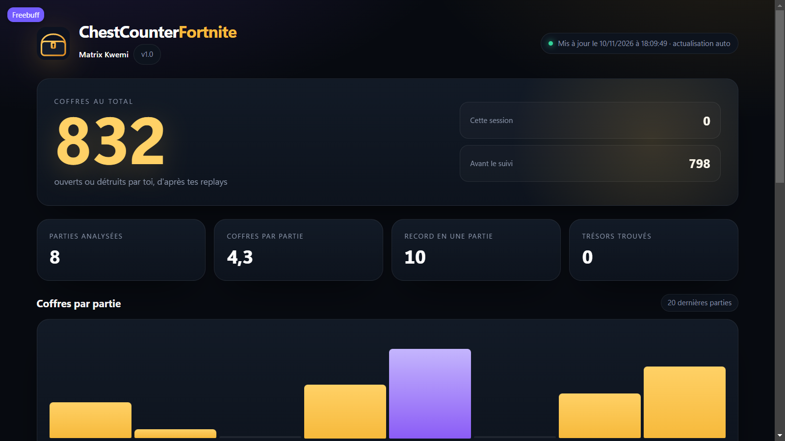
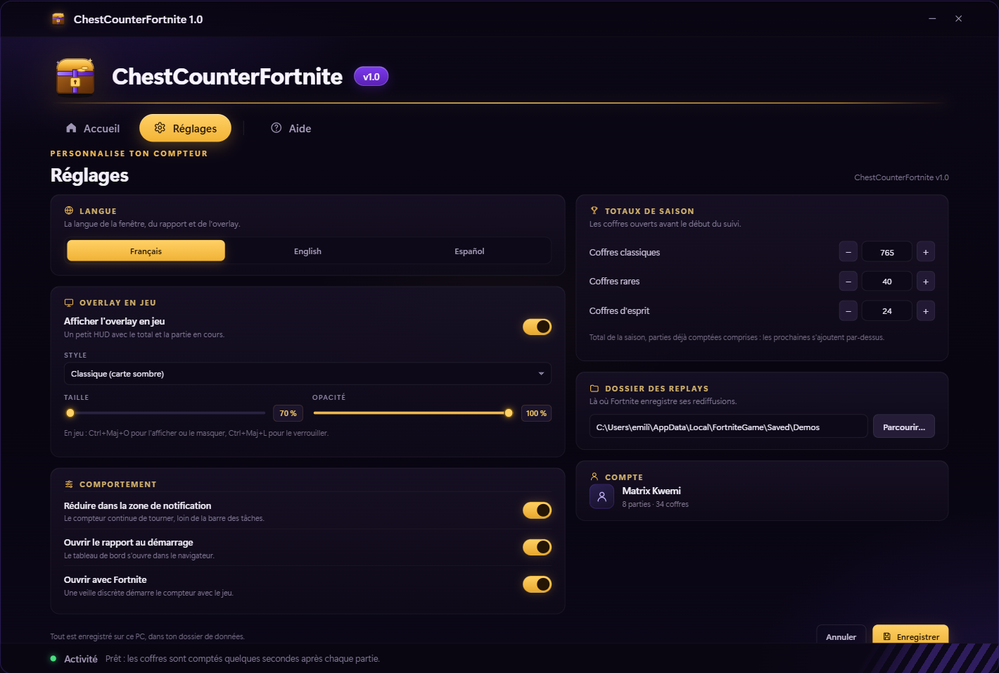
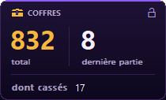

<div align="center">



# ChestCounterFortnite

**Compteur de coffres Fortnite — version personnelle de LayroZZ.**

[](https://github.com/emilien-atr/ChestCounterFortnite/releases)
[](#)
[](#)
[](LICENSE)

**Il lit les rediffusions Fortnite, compte les coffres que tu ouvres et garde ton historique.**
**Overlay en jeu + rapport web, sans jamais toucher au jeu.**

</div>

---

## Aperçu

<p align="center">
  
</p>

<p align="center">
  
  
</p>

## Ce que fait le compteur

- **Compte les coffres** que tu ouvres, partie après partie, à partir des `.replay` enregistrés par Fortnite.
- **Détaille les types** : coffres classiques, rares, d'esprit et coffres cassés.
- **Suit les trésors** trouvés dans les coffres.
- **Garde l'historique** de tes parties et de tes sessions.
- **Affiche un overlay** transparent par-dessus le jeu, dans le style du HUD, avec ton total, les coffres de la session et le nombre de coffres cassés.
- **Ouvre un rapport web** complet : tableau de bord, graphiques, dernières parties, répartition par type.
- **Parle français, anglais et espagnol.**
- **Reste hors ligne** : aucune donnée n'est envoyée, aucune mise à jour ne remplace ta version.

> [!IMPORTANT]
> **Les rediffusions doivent être activées dans Fortnite** : *Paramètres → Jeu → Rediffusions → Enregistrer les rediffusions*. Sans elles, le compteur n'a rien à lire.

## Installation

1. Télécharge **`ChestCounterFortnite.exe`** depuis la page des versions du dépôt.
2. Active les rediffusions dans Fortnite (voir ci-dessus).
3. Lance l'exécutable. Windows peut afficher *« Windows a protégé votre ordinateur »* : clique sur **Informations complémentaires → Exécuter quand même**.
4. Au premier lancement, choisis ta langue, vérifie le dossier des rediffusions, puis laisse le compteur analyser les parties déjà présentes.

Le programme vit dans la zone de notification. Il peut se lancer avec Fortnite et s'arrêter avec lui.

## Où sont mes données ?

Tout est local, dans :

```
%APPDATA%\ChestCounterFortnite\
```

- `data.json` — coffres, parties, historique
- `config.json` — langue, overlay, démarrage automatique
- `report.html` — le rapport web régénéré

Le compteur ne modifie jamais Fortnite, ne lit pas sa mémoire et n'envoie rien sur Internet.

## Le rapport

Le rapport est un tableau de bord sombre, aux couleurs du projet : le total de coffres en or, la répartition par type, les coffres cassés, les trésors et les dernières parties. Il s'ouvre dans ton navigateur et se met à jour après chaque partie.

## L'overlay

Deux styles sont disponibles :

- **Classic** — la carte compacte, logo doré, total et session.
- **HUD** — une ligne discrète, comme le reste de l'interface Fortnite.

La taille et la position se règlent dans les réglages du compteur ; l'overlay se verrouille pour ne pas gêner en jeu.

## Compiler

Prérequis : **.NET 10 SDK** et Windows 10/11.

```bat
git clone https://github.com/emilien-atr/ChestCounterFortnite.git
cd ChestCounterFortnite
dotnet publish src/ChestCounter/ChestCounter.csproj -c Release -r win-x64 --self-contained true -p:PublishSingleFile=true -p:IncludeNativeLibrariesForSelfExtract=true -p:EnableCompressionInSingleFile=true -p:DebugType=none -o dist
```

L'exécutable est généré dans `dist\ChestCounterFortnite.exe`. Les bibliothèques de lecture des replays sont dans `lib/` ; elles sont compilées avec le projet.

## Structure

```
src/ChestCounter/          application (WinForms + WebView2)
  Ui/app.html              fenêtre de réglages
  ReportSite.cs            génération du rapport web
  NativeOverlay.cs         overlay en jeu
  Tracker.cs               suivi des parties
lib/                       lecteur de replays, Unreal.Core, OozSharp
docs/                      captures d'origine
```

## Crédits

Ce projet est une version personnelle, adaptée de **[LED-N/Fortnite-ChestCounter](https://github.com/LED-N/Fortnite-ChestCounter)** (licence MIT). Merci à LED-N pour le compteur d'origine et à tous les contributeurs des bibliothèques de lecture de replays.

- [FortniteReplayReader](https://github.com/Shiqan/FortniteReplayReader)
- [OozSharp](https://github.com/KnowingNothing/OozSharp)
- [Unreal.Core](https://github.com/Shiqan/FortniteReplayReader)
- Police **Pirata One** (SIL Open Font License)

## Licence

[MIT](LICENSE) — utilise-le, modifies-le, partage-le.
