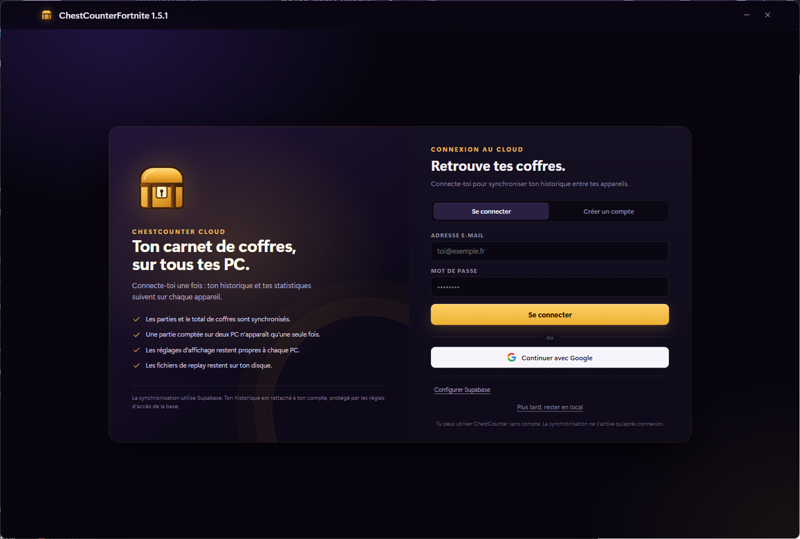
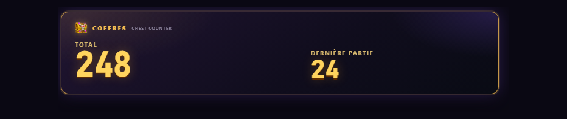

<div align="center">


# ChestCounterFortnite

**Tes coffres Fortnite, comptés automatiquement.**

Historique, statistiques et overlays OBS/TikTok, avec synchronisation optionnelle entre tes PC.

[](https://github.com/emilien-atr/ChestCounterFortnite/releases/latest)
[](#)
[](LICENSE)


</div>

## En bref

- Compte les coffres à partir des **rediffusions Fortnite**, quelques secondes après chaque partie.
- Affiche la **carte violette** en jeu et fournit un **overlay de stream compact** pour OBS et TikTok Live Studio.
- L’overlay **s’adapte automatiquement à la taille de la source** : aucune taille fixe à régler.
- **Compte optionnel** : connecte-toi par e-mail ou avec Google pour retrouver ton historique et tes totaux sur tes autres PC.
- Rapports web, historique, archives ZIP, activité Discord et mises à jour automatiques.
- Français, anglais et espagnol.

## Installation

1. Télécharge la [dernière version](https://github.com/emilien-atr/ChestCounterFortnite/releases/latest).
2. Active les rediffusions dans **Fortnite → Paramètres → Jeu → Rediffusions**, puis clique sur **Appliquer**.
3. Lance `ChestCounterFortnite.exe`. Windows peut afficher un avertissement car l’exécutable n’est pas signé : **Informations complémentaires → Exécuter quand même**.

## Compte et synchronisation



La connexion est **optionnelle** : « Plus tard, rester en local » permet d’utiliser le compteur sans compte. Une fois connecté, l’historique et les totaux manuels suivent le compte sur tous tes PC ; les réglages et les fichiers `.replay` restent locaux. La configuration Supabase est décrite dans [`docs/SUPABASE.md`](docs/SUPABASE.md).

## Overlay de stream



- **Overlay de jeu** : version compacte pour le stream, avec le total et le badge LIVE.
- Il s’adapte à la source, sans redimensionnement manuel.

Dans OBS, ajoute une source **Navigateur**. Dans TikTok Live Studio, utilise une source **Lien** et colle le **lien HTTPS** affiché dans **Réglages → OBS / TikTok Live Studio**. Garde le compteur ouvert pendant le live.

## Données

Tout est enregistré dans `%APPDATA%\ChestCounterFortnite`. Les replays restent sur ton disque ; avec un compte, seul l’historique est synchronisé. Aucune donnée de jeu n’est envoyée sans connexion.

<details>
<summary><b>Compiler depuis les sources</b></summary>

Prérequis : **.NET 10 SDK** et Windows 10/11.

```bat
dotnet publish src/ChestCounter/ChestCounter.csproj -c Release -r win-x64 --self-contained true -p:PublishSingleFile=true -p:IncludeNativeLibrariesForSelfExtract=true -p:EnableCompressionInSingleFile=true -p:DebugType=none -o dist
```

</details>

## Licence et crédits

[MIT](LICENSE) © 2026 **Emilien Autran**. Projet indépendant inspiré de [LED-N/Fortnite-ChestCounter](https://github.com/LED-N/Fortnite-ChestCounter) (MIT), avec [FortniteReplayReader](https://github.com/Shiqan/FortniteReplayReader), OozSharp, Unreal.Core, [DiscordRichPresence](https://github.com/Lachee/discord-rpc-csharp) (MIT) et la police Pirata One (SIL OFL).

Ce projet n’est ni affilié, ni approuvé, ni sponsorisé par Epic Games. Fortnite est une marque d’Epic Games, Inc.
